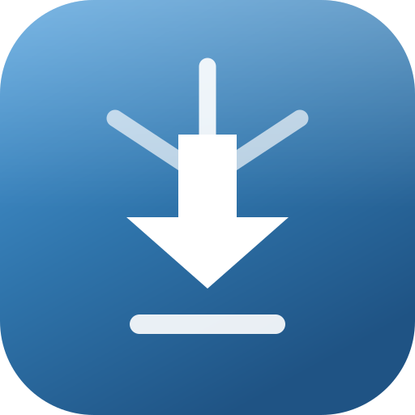
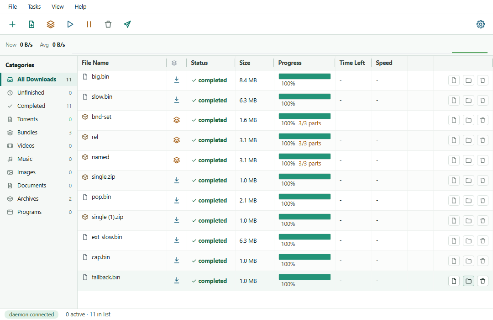
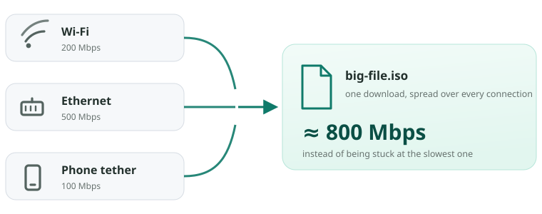
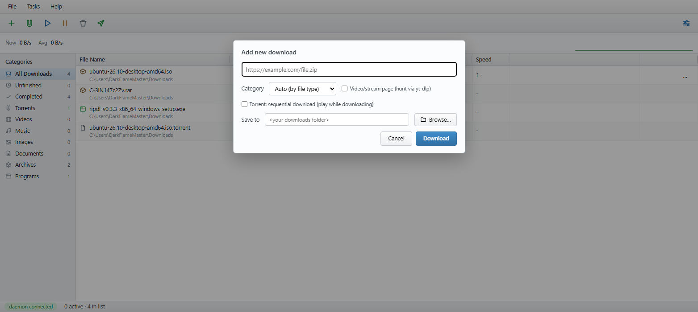
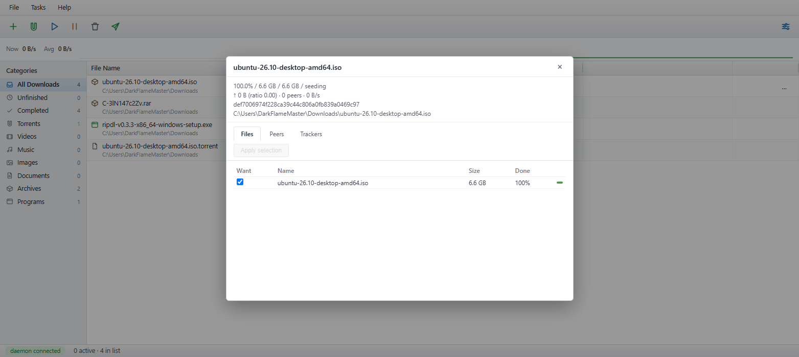
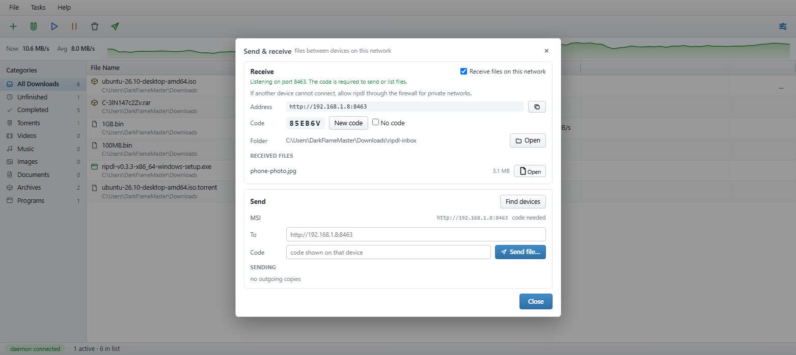
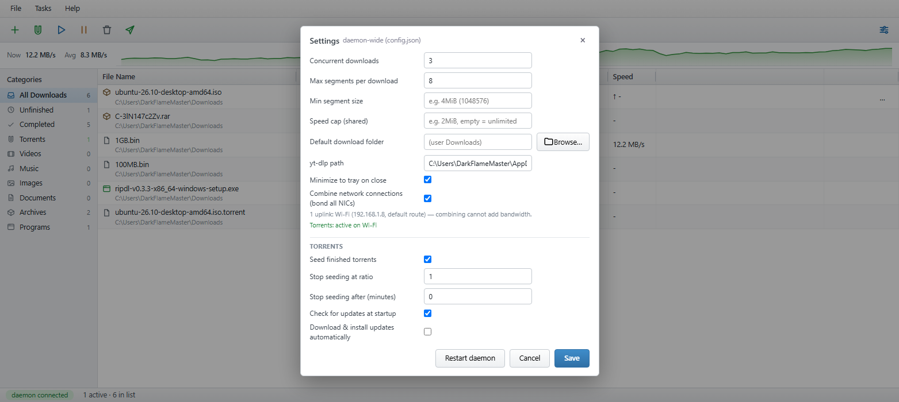

<p align="center">
  
</p>

<h1 align="center">ripdl</h1>

<p align="center">
  <b>A free, ad-free download manager for Windows and Linux.</b><br>
  Fast HTTP downloads, torrents, video pages and same-network file transfer —
  with no account, no ads and no telemetry.
</p>

<p align="center">
  <a href="https://github.com/ShiniM0d0ri/ripdl/releases/latest"></a>
  
  
</p>

<p align="center">
  <a href="https://github.com/ShiniM0d0ri/ripdl/releases/latest"><b>⬇ Download for Windows</b></a>
  &nbsp;·&nbsp;
  <a href="#one-download-over-every-connection">Combine connections</a>
  &nbsp;·&nbsp;
  <a href="#command-line">Command line</a>
  &nbsp;·&nbsp;
  <a href="#troubleshooting">Troubleshooting</a>
</p>

<p align="center">
  
</p>

## What is ripdl?

A download manager is a program that grabs files **faster and more reliably
than a browser**: it opens several connections to the same file, keeps a queue,
and picks up exactly where it left off after a crash, a reboot or a lost Wi-Fi
connection.

ripdl also handles **torrents**, **video pages** (via yt-dlp) and **sending
files to your own devices** over Wi-Fi. It is open source, so it is free
forever — there is nothing to buy, nothing to activate, and nothing that phones
home.

## Why switch from IDM / FDM / aria2?

|  | ripdl |
|---|---|
| Price | Free, forever (MIT OR Apache-2.0) |
| Ads, bundled offers, "get premium" | None |
| Telemetry, accounts, crash reporting | None |
| Torrents, video pages, LAN transfer | Included |
| One download over several uplinks at once | Yes — see [below](#one-download-over-every-connection) |
| GUI + command line | Both, one engine |
| Platforms | Windows 10/11, Linux |

## One download, over every connection

The trick almost nobody else bothers with: download managers can split a file
into several connections, but they all leave through the **same** network
interface. ripdl can put them on **different** uplinks at the same time — Wi-Fi
and a network cable, or a tethered phone — so a single file downloads over all
of them.

<p align="center">
  
</p>

Turn it on in **Settings → Combine network connections**, or add `--bond` on the
command line (`ripdl download --bond <url>`). Every parallel connection gets its
own source address, so a server that throttles "one client" sees several and the
bytes add up.

**Honest limits:** the uplinks must be genuinely independent. A cable and Wi-Fi
that both belong to the same router still share one ISP line, so you gain
nothing; a laptop on Wi-Fi plus a phone on mobile data (USB-tethered) really do
add up. It is off by default for that reason.

Torrents follow the network too: the set of uplinks is re-read every few
seconds (plug the phone in later and it joins without a restart), and new peer
connections are weighted by what each uplink **actually delivers**. A tethered
phone that drops from 30 Mbps to 2 Mbps stops receiving half the swarm — ripdl
measures the bytes each link moves and sends new connections to the fast one,
quarantining a link that falls below 5 % of the best until it recovers.
`ripdl config` (and Settings) show the live per-uplink rates.

An uplink also has to *prove* it works: a phone tether that loses its data
connection (a call, a dead spot) keeps its adapter up, its address and even its
DHCP gateway, so it looks like a normal interface while every packet is
dropped. ripdl probes each uplink with a source-bound TCP handshake before
bonding it, drops a link after two failed probes and re-adopts it on the first
success — no dead path ever eats half the peer connections.

## Features

- **Fast, resumable downloads** — up to 8 parallel connections per file when
  the server allows it, one steady stream when it doesn't. Pause, close the app
  or crash: it resumes from the last byte.
- **One file, several uplinks** — see
  [above](#one-download-over-every-connection): Wi-Fi + cable + tethering, used
  together.
- **A queue you can actually control** — pause/resume/remove, sort by speed or
  size, limit how many run at once, cap total speed, or schedule a task for
  later ("in 1 hour", "at 22:30").
- **Torrents** — `.torrent` files and magnets, per-file selection, sequential
  (stream-while-downloading) mode, seeding with ratio/time limits, live
  files/peers/trackers view.
- **Video and stream pages** — send a page to
  [yt-dlp](https://github.com/yt-dlp/yt-dlp) from the Add dialog or with
  `--video`; progress is shown as a percentage.
- **Send files to your phone, or between two PCs** — a code-protected page on
  your own Wi-Fi: open it in any browser, drop files in, or download what is
  there. No cloud, no account, no size limit.
- **Tray + background** — close the window and downloads keep going.

## Install

**Windows (recommended)**
Download `ripdl-v<version>-x86_64-windows-setup.exe` from the
[latest release](https://github.com/ShiniM0d0ri/ripdl/releases/latest) and run
it. It installs to `C:\Program Files\ripdl`, adds a Start-menu entry and opens
the app. New versions install with one click from inside the app. Prefer no
installer? Use the portable `.zip` and unzip anywhere.

*Requirements:* Windows 10/11 (the WebView2 runtime that ships with Edge), or a
modern Linux desktop. No .NET, no Java, no extra runtimes.

**Linux**

- Debian/Ubuntu: `sudo apt install ./ripdl_<version>_amd64.deb`
- Fedora: `sudo dnf install ./ripdl-<version>-1.x86_64.rpm`
- Any distro:
  `tar -xzf ripdl-v<version>-x86_64-linux.tar.gz && sudo cp ripdl-v*/ripdl ripdl-v*/ripdl-daemon ripdl-v*/ripdl-gui /usr/local/bin/`

## Your first download (30 seconds)

1. Open ripdl and click the **+** button (or press `Ctrl+N`).
2. Paste a link, press **Download**. Change the folder if you don't want the
   default Downloads one.
3. Watch it go. Right-click a row to pause, resume, open the file or remove it.

<p align="center">
  
</p>

The list is remembered: downloads keep running while the window sits in the
tray, and unfinished ones resume when you start ripdl again.

### What do the buttons do?

The toolbar is icon-only (hover anything for a tooltip):

| Button | What it does |
|---|---|
| **+** | Add a download URL (`Ctrl+N`) |
| **magnet** | Add a torrent file (`Ctrl+T`) — or drop one on the window |
| **▶** | Resume every paused or failed task |
| **⏸** | Pause every running task |
| **trash** | Clear completed tasks from the list (files stay on disk) |
| **paper plane** | Send / receive files on your network |
| **sliders** | Settings |

On a task row: **double-click** opens details (segments, torrent files/peers),
**right-click** gives pause, resume, refresh address, open file/folder and
remove.

## Torrents

Click the magnet button (or `Ctrl+T`) to open a `.torrent` file, or paste a
magnet link into Add. Single-file torrents land directly in Downloads;
multi-file torrents get their own folder. Double-click a torrent row to see its
files, peers and trackers — and untick anything you don't want.

<p align="center">
  
</p>

## Send a file to your phone, or between two PCs

1. Click the paper-plane button (**Send & Receive**).
2. Turn on **Receive files on this network**. ripdl shows an address such as
   `http://192.168.1.8:8463` and a short code.
3. On your phone (same Wi-Fi) open that address in any browser, type the code,
   pick a file and press **Send**. It appears in `Downloads\ripdl-inbox`.
4. To send *from* this PC, pick the other device under **Send** (or type its
   address and code) and click **Send file…**.

<p align="center">
  
</p>

Nothing leaves your network. The code is the key — turn on **No code** only on
a network you trust.

## Settings worth knowing

<p align="center">
  
</p>

- **Concurrent downloads / max segments** — how many tasks run at once, and how
  many connections each one gets (8 is a good default).
- **Combine network connections** — spread one download over every uplink
  (see [above](#one-download-over-every-connection)).
- **Speed cap** — one shared limit for everything (`2MiB`, `500k`, empty =
  unlimited).
- **Default download folder** — where new tasks go.
- **Minimize to tray on close** — keep downloading in the background.
- **Seed finished torrents** — ratio and time limits for after a torrent ends.
- **Check for updates at startup** — one GitHub request per launch, can be
  turned off.

## Command line

Optional — the app does everything — but handy for scripts and servers:

```sh
ripdl add https://example.com/big.iso          # queue it in the background
ripdl ls                                        # what is running, with speeds
ripdl pause <id> | ripdl resume <id> | ripdl rm <id> [--files]

ripdl download <url> -o ~/Downloads -s 16       # one-off download, no daemon
ripdl add --after 1h <url>                      # start it later
ripdl add <magnet-or-.torrent> --sequential     # torrents
ripdl add --video "https://youtube.com/watch?v=..."   # needs yt-dlp

ripdl lan info                                  # this PC's address + code
ripdl lan send photo.jpg --to http://192.168.1.8:8463 --code ABC123

ripdl config                                    # see or change settings
ripdl update                                    # check for a newer release
```

Run `ripdl --help` for the full list, and `ripdl <command> --help` for flags.

## Browser extension (optional)

The extension hands downloads to ripdl instead of the browser's own downloader
— right-click a link → **Download link with ripdl**. Set it up once:

1. Run `ripdl register-host` (the Windows installer already does this).
2. In ripdl Settings, open **Browser extension**. Click **Open extension
  settings**, enable **Developer mode**, and choose **Load unpacked**.
3. Select the app-managed folder shown in Settings. ripdl creates it under
  its per-user data directory and updates it with the app.
4. Right-click any link → **Download link with ripdl**. After an app update,
  reload the extension when Settings reports that the browser copy is behind.

It only acts when you click, and it never reads pages in the background.

## Staying up to date

The app checks GitHub once per launch and shows a banner with **Download &
Install**: the installer is verified against its SHA-256 before it runs. Turn on
*Download & install updates automatically* in Settings to make that hands-off.
`ripdl update --install` does the same from the CLI.

## Uninstall

- **Windows:** Settings → Apps → ripdl → Uninstall. Your downloaded files stay
  exactly where they are.
- **Linux:** remove the package (`apt remove ripdl` / `dnf remove ripdl`) or the
  three binaries you copied.

Queue and settings live in `%LOCALAPPDATA%\ripdl` (Windows) or
`~/.local/share/ripdl` (Linux) — delete that folder too if you want a completely
clean machine.

## Privacy

No analytics, no crash reporting, no ads, no accounts. ripdl connects only to:

- the download addresses you give it (and torrent trackers/files you open),
- `api.github.com` for the update check (can be disabled in Settings),
- your local network, and only if you turn on Send & Receive.

## Troubleshooting

**The other device can't connect (Send & Receive).**
Allow ripdl through Windows Firewall for *private* networks, and make sure both
devices are on the same Wi-Fi/LAN. Guest networks, "client isolation" and some
VPNs block device-to-device traffic.

**A video page fails.**
Video mode needs [yt-dlp](https://github.com/yt-dlp/yt-dlp):
`winget install yt-dlp.yt-dlp`. If it isn't on `PATH`, set its full path in
Settings → *yt-dlp path*.

**The download is slower than expected.**
Many servers throttle each connection; raising *Max segments* can help. If a
server doesn't support ranges, ripdl deliberately uses a single stream.

**"File already exists".**
ripdl never overwrites silently — remove the old task or choose another folder.

## Build from source

```sh
cargo build --release   # Rust stable; the GUI needs WebKit2GTK dev packages on Linux
cargo test              # fully offline, no real networks
```

Workspace layout: `ripdl-core` (engine), `ripdl-daemon` (background queue),
`ripdl-gui` (Tauri window), `ripdl-cli`. What is done and what is next lives in
[docs/ROADMAP.md](docs/ROADMAP.md).

## License

MIT OR Apache-2.0, at your option — see [LICENSE-MIT](LICENSE-MIT) and
[LICENSE-APACHE](LICENSE-APACHE).
